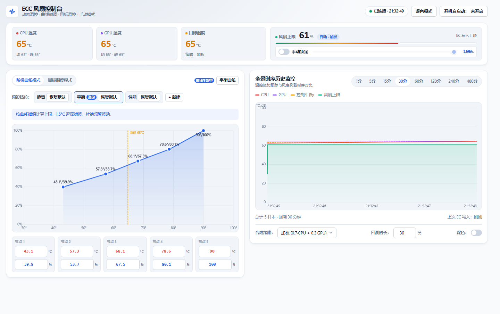

# ECC Fan Controller

[](https://github.com/buglyz/ecc/actions/workflows/build.yml) [](https://github.com/buglyz/ecc/actions/workflows/release.yml)

笔记本 EC（Embedded Controller）风扇控制器：通过写入 EC 寄存器实现自定义风扇转速曲线，搭载现代化玻璃态 Web UI。纯 Go 标准库实现，单文件运行，无外部运行时依赖。

> **QNLXS / SQ131 分支**：风扇写入默认通过 **PawnIO**（微软 WHCP 签名、兼容 HVCI）+ `LpcACPIEC.bin` 直接读写 EC `0x2C/0x2D`；温度/RPM 通过 `GmwmiCli.exe` 只读。**不需要关闭内存完整性**。`ec-probe`/WinRing0 仅作为回退路径。
>
> 本分支已在 Hasee QNLXS（i7-12650H + RTX 4060，BIOS SQ131）上完成只读验证与 100% 受控写入验证：`0x2C/0x2D` 为占空比上限，`0x2E/0x2F` 为 EC 实际占空比，`0x58` 为 CPU 温度。

> 由[此 B 站项目](https://www.bilibili.com/video/BV1oaaoeFEzY/?share_source=copy_web&vd_source=02adb0cd5f8f9003d535f030aa4f3266)修改而来。

> 项目主页：[buglyz.github.io/ecc](https://buglyz.github.io/ecc/) · 下载最新版：[Releases](https://github.com/buglyz/ecc/releases/latest)

## 目录

- [预览](#预览)
- [核心特性](#-核心特性)
- [快速开始](#-快速开始)
- [命令行参数](#命令行参数)
- [工作原理](#-工作原理)
- [硬件兼容性](#️-硬件兼容性)
- [从源码编译](#-从源码编译)
- [项目结构](#-项目结构)
- [故障排查](#-故障排查)

## 预览




## 🌟 核心特性

- 🎨 **现代化玻璃态 Web UI** — Fluent/Glassmorphism 设计，深色/浅色自适应，响应式布局。
- 📈 **双轨制曲线编辑器** — 画布上拖拽控制点，或在表格中精确键入温度/转速，双向实时同步。
- 📊 **实时监控图表** — CPU/GPU 温度与风扇响应趋势，回溯范围 1–480 分钟可调。
- ⚙️ **多模式调速** — 自动模式支持加权 / 取最大值 / 仅 CPU / 仅 GPU 四种温度策略；手动模式一键锁定绝对转速。
- 🌡️ **目标温度模式** — 比例律 + 死区 + 速率限制，自动调整 EC 上限来维持目标温度；与曲线模式可随时切换。
- 🕹️ **场景预设** — 内置 静音 / 平衡 / 性能 三挡，支持创建、修改、保存个人挡位。
- 🚀 **系统级集成** — 动态托盘图标、开机自启动（Program Files 安装免 UAC；其他目录以当前用户权限启动，登录时请求 UAC）、启动自动提权。
- 🧭 **重复启动保护** — 与端口无关的全局命名互斥体；已有实例运行时直接打开现有控制台，不启动第二套硬件控制循环。
- 🐕 **独立看门狗** — 分离进程监控心跳；主进程被强杀、崩溃或控制循环卡死导致心跳 30 秒未更新时，自动把 EC 上限写回 `FF/FF`。
- 🤝 **原厂所有权仲裁** — 监听 `FanControlStatus`；原厂 ControlCenter 重新启用风扇控制时，ECC 主动退出并释放。
- 💬 **可见操作反馈** — 配置、预设和开机自启动的成功或失败会在页面内明确提示。
- 🔒 **API 防护** — 写接口校验页面注入的会话令牌与回环 Host，拒绝 CSRF / DNS rebinding 篡改风扇配置。
- 🛡️ **健壮性** — 温度传感器掉线指数退避重启、EC 写入失败托盘告警、配置损坏自动备份恢复。

## 🚀 快速开始

### 运行要求

- Windows 10 / 11（x64）
- 管理员权限（访问 EC 寄存器需要内核驱动）
- **PawnIO 2.x**（默认 EC 后端，微软 WHCP 签名，兼容 HVCI）。安装包会自动安装；也可手动执行 `winget install namazso.PawnIO`。
- `ecc.exe` 同目录下的 `assets/` 需包含以下随包分发的文件：

  | 文件 | 作用 |
  |------|------|
  | `assets/pawnio/LpcACPIEC.bin` | PawnIO 的 ACPI EC 模块（LGPL-2.1，默认后端） |
  | `assets/pawnio/PawnIO_setup.exe` | 官方 PawnIO 2.2.0 安装器（GPL-2.0，安装时自动运行） |
  | `GmwmiCli.exe` | 只读温度/RPM 的 WMI 薄封装 |
  | `LibreHardwareMonitorLib.dll` | 读取 CPU/GPU 温度 |

  以下文件仅在便携版/开发环境的 ec-probe 回退路径中保留；**EXE 安装包不包含它们**，以精简包体并减少未签名 PE 带来的杀软误报：

  | 文件 | 作用 |
  |------|------|
  | `ec-probe.exe` | NBFC 的 EC 读写工具（回退） |
  | `nbfc.exe` / `StagWare.*` / `Plugins/` | NBFC 依赖（回退路径不使用） |

> PawnIO 由 namazso 提供，驱动本体为 GPL-2.0；安装器按其声明原样分发。来源、哈希与许可见 `assets/pawnio/NOTICE.md`。

### 安装与使用

**方式一：安装包（推荐）**

1. 从 [Releases](https://github.com/buglyz/ecc/releases) 下载 `ECC-Setup-<版本>.exe`。
2. 双击运行，按向导完成安装（自动请求管理员权限，默认安装到 `%ProgramFiles%\ECC`）。
3. 安装器会检测 PawnIO；未安装时自动运行 `PawnIO_setup.exe -install -silent`（已安装则跳过）。
4. 安装完成后从桌面或开始菜单启动，系统托盘出现图标，浏览器自动打开控制台 `http://127.0.0.1:8765`。
5. 在控制台中调整风扇曲线、切换预设、设置开机自启动。

> 安装版只包含 PawnIO 后端必需文件（`ecc.exe`、`GmwmiCli.exe`、LHM DLL、`assets/pawnio/*`），不包含 NBFC/ec-probe/Plugins，包体更小，也能降低杀软对未签名 PE 的启发式误报。
>
> 卸载：Windows「设置 → 应用 → 已安装的应用」中卸载 ECC Fan Controller。
> ECC 不会自动卸载 PawnIO，因为它可能被其他程序共享使用。

**方式二：便携版 ZIP**

1. 下载并解压 `ecc-<版本>-windows-amd64.zip`，右键 `install.ps1` 以管理员身份运行 PowerShell。
2. 后续步骤同上。
3. 卸载：运行 `uninstall.ps1`（加 `-KeepConfig` 可保留配置）。

> 开机自启动：安装在 Program Files 时创建最高权限计划任务，登录免 UAC；安装在其他目录时创建普通权限计划任务，登录时会请求一次 UAC。这样既支持自定义安装目录，也避免提权任务指向用户可写路径。

### 命令行参数

| 参数 | 默认 | 说明 |
|------|------|------|
| `--port` | `8765` | Web 控制台端口 |
| `--interval` | `1000` | 正整数采样间隔（毫秒） |
| `--dry-run` | 关 | 仅记录 EC 写入，不操作硬件 |
| `--simulate` | 关 | 使用模拟温度数据（同时启用 dry-run） |
| `--no-pawnio` | 关 | 禁用 PawnIO，强制使用 ec-probe/WinRing0 回退 |
| `--skip-admin` | 关 | 跳过管理员权限检查 |
| `--no-tray` | 关 | 禁用系统托盘图标 |
| `--no-browser` | 关 | 启动时不自动打开浏览器 |
| `--shutdown` | 关 | 通知已运行实例优雅退出（安装器/卸载器使用） |

## 🔬 工作原理

本程序的核心是一个「读温度 → 算目标转速 → 写 EC 寄存器」的闭环控制循环。

```
                    ┌─────────────────────────────────────────────┐
                    │              控制循环 (每秒采样)               │
                    │                                             │
  温度读取           │   ┌──────────┐   温度策略      ┌──────────┐  │   EC 写入
┌──────────┐        │   │ 采样窗口  │─────────────→ │ 曲线插值  │  │  ┌──────────┐
│PowerShell│───────→│   │ (6 次)   │  加权/max/单路 │ 求目标转速 │  │─→│ec-probe  │──→ EC 寄存器
│  + LHM   │ CPU/GPU │   └──────────┘               └──────────┘  │  │  .exe    │   0x2C/0x2D
└──────────┘  温度   │        │                          │        │  └──────────┘
                    │        │        ┌──────────┐      │        │
  RPM 反馈           │        └───────→│ 滞回/漂移 │←─────┘        │
┌──────────┐  实际转速 │                 │ 心跳判断  │              │
│ec-probe  │───────→│                 └──────────┘              │
│0xB0-0xB3 │        └─────────────────────────────────────────────┘
                              ↑                    ↓
                         ┌─────────┐         ┌──────────┐
                         │ Web UI  │←───────→│  配置     │
                         │ 曲线编辑 │  HTTP   │ JSON 持久化│
                         └─────────┘   API   └──────────┘
```

### 1. 温度采集（`internal/sensors`）

程序**不直接读硬件传感器**，而是通过一个常驻的 PowerShell 子进程桥接 [LibreHardwareMonitor](https://github.com/LibreHardwareMonitor/LibreHardwareMonitor)（LHM）：

1. 首次读取时，启动携带内嵌编码命令的 `powershell.exe`，并通过受控环境变量向脚本传入 `LibreHardwareMonitorLib.dll` 路径。
2. 主程序通过 stdin 发送 `read\n`，PowerShell 侧读取所有 CPU/GPU 温度传感器，以 JSON 单行 (`{"cpu":63.5,"gpu":58.0}`) 从 stdout 返回。
3. 主程序设 5 秒读取超时；超时或子进程崩溃即杀掉并重启。
4. **指数退避**：连续失败时重启间隔按 1s→2s→4s…（上限 30s）递增，避免子进程反复崩溃时每秒白白 spawn 一个 `powershell.exe`。读到有效数据后计数清零。

> 为什么用子进程而不是 CGO 直接调 DLL？因为 LHM 是 .NET 程序集，Go 无法直接调用；PowerShell 是 Windows 自带的最省事的 .NET 宿主，且进程隔离让 DLL 崩溃不会拖垮主程序。

### 2. 温度策略（`internal/controller/logic.go` · `CombineTemps`）

一个采样周期含 **6 次采样**（`SamplesPerCycle`，每秒一次）。每次采样都把 CPU/GPU 两路温度按当前策略合并成单个「目标温度」：

| 策略 | 计算方式 |
|------|---------|
| `weighted`（默认） | `0.7 × CPU + 0.3 × GPU` |
| `max` | `max(CPU, GPU)` |
| `cpu` | 仅 CPU |
| `gpu` | 仅 GPU |

周期结束时，对 6 次的目标温度取算术平均，得到本周期的代表温度 `avg`。取平均是为了平滑瞬时尖峰，避免风扇因一次采样毛刺而频繁调速。

### 3. 曲线插值（`internal/controller/logic.go` · `InterpolateCurve`）

风扇曲线是 5 个 `(温度, 转速%)` 控制点。用平均温度 `avg` 做**分段线性插值**求目标转速：

- `avg` 低于最低点温度 → 取最低点转速
- `avg` 高于最高点温度 → 取最高点转速（封顶 100%）
- 落在两点之间 → 线性插值：`s1 + (avg−t1)/(t2−t1) × (s2−s1)`

结果经 `ClampSpeed` 限幅到 `[0, 100]` 并四舍五入为整数百分比。

### 3.1 目标温度模式（可选，`internal/controller/target.go`）

除了固定曲线，还可以选择「目标温度模式」。它不再查表，而是用温度误差直接计算 EC 上限。目标模式固定使用 **CPU/GPU 中较高的一路**，避免加权平均把热源平均掉：

```text
desired = Bias + KP × (avg - Target)
desired = clamp(desired, Min, Max)

if |avg - Target| <= Hysteresis: 保持当前上限
if desired > current: 最多上调 UpStep
if desired < current: 最多下调 DownStep
```

默认值：

| 参数 | 默认 | 说明 |
|------|------|------|
| `Target` | 66°C | 想维持的温度 |
| `Hysteresis` | 4°C | 死区；2°C 偏紧，容易在 EC 斜坡上振荡 |
| `KP` | 5 | 每偏离 1°C 调整多少上限 |
| `Bias` | 55 | 误差为 0 时的基准上限 |
| `Min` / `Max` | 45 / 100 | 比例律的输出范围 |
| `UpStep` / `DownStep` | +30 / -10 | 每周期速率限制：放开快、收紧慢 |

注意：`0x2C/0x2D` 是**上限**，因此目标温度模式只能把风扇压到 EC 原厂曲线以下，不能把风扇推到原厂曲线以上。高温硬保护仍然优先：CPU≥92°C 或 GPU≥87°C 时写入 `0xFF` 交还 EC 曲线，并保持到 CPU<87°C、GPU<82°C 才恢复普通控制，避免在阈值附近反复升降档。

应用预设挡位会自动切回曲线模式；目标模式下曲线编辑器会被禁用，避免误以为编辑曲线会生效。

### 4. 何时才真正写 EC —— 滞回、漂移、心跳（`internal/controller/controller.go`）

算出目标转速后**并不是每周期都写**，写入受多重条件门控，以减少无谓的 EC 操作与风扇转速抖动：

- **滞回 (Hysteresis)**：若本周期平均温度与「上次已提交温度」相差 `< 1.5°C`（`HysteresisTemp`），视为温度已稳定，跳过写入。防止温度在临界点附近来回摆动导致风扇忽快忽慢。
- **漂移 (Drift)**：若一个周期实际耗时偏离预期（6 × 当前采样间隔 + 抖动容差）超过 `LoopDriftTolerance`（系统卡顿、休眠唤醒等），强制写一次校正。
- **心跳 (Heartbeat)**：即使温度稳定，每 `10s`（`HeartbeatInterval`）也强制写一次，防止 EC 因固件看门狗把风扇控制权收回。
- **配置变化**：用户在 Web UI 改了曲线/策略（配置版本号递增），立即强制写入，不等心跳，保证改动秒级生效。
- **手动模式**：直接锁定用户指定的转速百分比，绕过曲线计算。

只有「目标转速变了 **或** 漂移 **或** 心跳到期 **或** 配置变化」时才调用写入。

### 5. 写入 EC 寄存器

#### 5.0 默认后端：PawnIO（`internal/pawnio`）

默认路径不调用 `ec-probe.exe`，而是通过 PawnIO 的 `LpcACPIEC.bin` 模块直接做 ACPI EC 端口 I/O：

```
ecc.exe → PawnIO 设备 (\\.\GLOBALROOT\Device\PawnIO)
        → ioctl_pio_read/write(0x66/0x62)
        → EC 0x2C / 0x2D
```

| 寄存器 | 含义 | 说明 |
|--------|------|------|
| `0x2C` / `0x2D` | CPU/GPU 占空比**上限** | `0x00`–`0x64` 有效；`0xFF` = 跟随 EC 原厂曲线 |
| `0x2E` / `0x2F` | EC **实际**占空比 | 只读，EC 以约 10 秒斜坡逼近上限 |
| `0x58` | CPU 温度 | 摄氏度 |
| `0x59` | 另一路温度 | 摄氏度 |

- 模块哈希固定为 `c38fd116…f7906`，不匹配会拒绝加载。
- 需要 PawnIO 服务运行；程序会在打开设备失败时尝试 `sc start PawnIO`。
- 每次写入后回读校验；失败返回 false，由控制循环重试/告警。
- 退出、异常、连续无温度时写 `0xFF/0xFF`，交还 EC 自动曲线。

#### 5.1 回退后端：ec-probe / WinRing0（`internal/ec/writer.go`）

以下 5.1–5.5 描述的是 `--no-pawnio` 或 PawnIO 不可用时的回退路径。程序调用 NBFC 的 `ec-probe.exe`：

```
ec-probe.exe write -v 0x2C 0x32
                    │    │    └─ 值：0x32 = 十进制 50 = 50% 转速
                    │    └────── 寄存器：0x2C = Fan1
                    └─────────── 命令：写入并回读验证 (-v)
```

#### 5.1 EC 是什么、为什么要写它

**EC（Embedded Controller，嵌入式控制器）** 是笔记本主板上一颗独立的微控制器，独立于 CPU 运行，负责电源管理、键盘、电池、温度监控和**风扇 PWM 调速**等底层任务。它对外暴露一组 8 位寄存器（共 256 个，地址 `0x00`–`0xFF`），操作系统通过读写这些寄存器与 EC 交互。风扇转速就由其中某几个寄存器的值决定。

#### 5.2 本程序使用的寄存器地址

| 寄存器地址 | 用途 | 取值范围 | 说明 |
|-----------|------|---------|------|
| `0x2C` | **Fan1 转速** | `0x00`–`0x64` (0–100) | 十进制百分比。`0x32`=50%，`0x64`=100% |
| `0x2D` | **Fan2 转速** | `0x00`–`0x64` (0–100) | 同上，第二个风扇 |
| `0x2C` / `0x2D` | **释放控制** | `0xFF` | 写 `0xFF` 交还固件自动调速 |
| `0xB0` / `0xB1` | Fan1 实际转速 (RPM) | 只读 | 低字节 / 高字节，小端组合成 16 位 RPM |
| `0xB2` / `0xB3` | Fan2 实际转速 (RPM) | 只读 | 低字节 / 高字节 |

> ⚠️ **这些地址是特定于本机型的**。不同厂商、不同型号笔记本的 EC 寄存器布局完全不同（`0x2C/0x2D` 是本项目目标机型逆向得到的地址）。换一台笔记本很可能需要重新用 [RWEverything](http://rweverything.com/) 之类工具逆向探测。定义见 `internal/controller/constants.go`：
>
> ```go
> ECRegFan1        = "0x2C"   // Fan1 转速百分比
> ECRegFan2        = "0x2D"   // Fan2 转速百分比
> ECRegFan1RPMLow  = "0xB0"   // Fan1 RPM 低字节
> ECRegFan1RPMHigh = "0xB1"   // Fan1 RPM 高字节
> ECFanRelease     = "0xFF"   // 释放控制
> ```

#### 5.3 一次写入的完整链路

以「设 Fan1 到 50%」为例，从 Go 代码到硬件寄存器的完整调用链：

```
控制循环 writeSpeed(50)
   │  toHex(50) → "0x32"       // 百分比转十六进制字符串
   ▼
ec.Writer.Write(ctx, "0x2C", "0x32")
   │  exec: ec-probe.exe write -v 0x2C 0x32
   ▼
ec-probe.exe (NBFC 工具, .NET)
   │  加载 WinRing0 内核驱动 (WinRing0x64.sys)
   ▼
WinRing0 驱动 (Ring 0 内核态)
   │  通过 IO 端口读写与 EC 握手
   ▼
EC 硬件访问协议 (端口 0x62 / 0x66)
   │  ① 等待 EC 空闲 (读状态端口 0x66，检查 IBF 位)
   │  ② 向命令端口 0x66 写 0x81 (WRITE_EC 命令)
   │  ③ 向数据端口 0x62 写寄存器地址 0x2C
   │  ④ 向数据端口 0x62 写数据 0x32
   ▼
EC 固件
   │  寄存器 0x2C 的值变为 0x32
   ▼
风扇 PWM 控制器 → 风扇以 50% 占空比转动
```

**关于 IO 端口 `0x62` / `0x66`**：这是 ACPI 标准定义的 EC 访问端口，几乎所有 x86 笔记本通用：
- `0x66` — **命令/状态端口**。读它得到状态字节（含 IBF 输入缓冲满、OBF 输出缓冲满标志位）；写它发送命令（`0x80`=读 EC、`0x81`=写 EC）。
- `0x62` — **数据端口**。读写实际的地址和数据字节。

访问这两个端口需要 Ring 0 内核态权限，用户态程序无法直接 `out`/`in`，这正是必须借助 **WinRing0 内核驱动**（一个签名的合法驱动，暴露端口读写能力给用户态）的原因，也是程序必须**以管理员权限运行**才能加载驱动的原因。

#### 5.4 写入策略与容错

- **双风扇都写**：程序对 Fan1 (`0x2C`) 和 Fan2 (`0x2D`) **各写一次**，两者都成功才算本次写入成功（`writeSpeed` 返回 `true`）。
- **写入超时**：每次 `ec-probe.exe` 调用设 5 秒超时（`writeTimeout`），防止驱动挂死拖住控制循环。
- **驱动失败检测**：`ec-probe write` 在 WinRing0 驱动加载失败时**仍返回退出码 0**（区别于 read/dump 返回 1）。只看退出码会把「驱动没加载、EC 根本没写进去」误判为成功，导致滞回逻辑以为已生效而不再重试。因此程序会扫描命令输出，命中 `unable to load the winring0 driver` 标志即判为失败（见 `writeSucceeded`），触发托盘告警并在下一周期重试。
- **只写不回读的机型**：部分笔记本的转速寄存器是**只写**的——写进去有效，但立即回读拿到的仍是旧值或 `0xFF`。因此程序**不依赖回读来确认转速生效**，只依赖 `ec-probe` 命令本身是否成功执行。
- **优雅退出**：程序停止时向两个寄存器写 `0xFF`（`ECFanRelease`），把风扇控制权交还给 EC 固件（恢复 BIOS 自动调速），避免退出后风扇卡在某个固定转速或长期满速。

> 💡 **手动验证写入是否生效**（管理员 PowerShell，在 `assets/` 目录下）：
> ```powershell
> .\ec-probe.exe read 0x2C           # 读当前值
> .\ec-probe.exe write 0x2C 0x32 -v  # 写 50% 并回读验证
> .\ec-probe.exe write 0x2C 0xFF     # 释放控制，交还固件
> ```

### 6. 转速反馈（GMWMI，默认）

为了在 UI 上显示风扇**实际转速**（而非仅设定的百分比），默认通过 `GmwmiCli.exe` 查询 `root\wmi:RW_GMWMI` 的 `0xFA00/0x0200`，其中 `a4/a5` 为 CPU/GPU RPM。读取失败或缺少 helper 时优雅降级，UI 不显示 RPM，不影响调速。

`ec-probe` 读取 EC `0xB0/0xB1`、`0xB2/0xB3` 的旧实现仅作为 `--no-pawnio` 回退路径保留。

### 7. Web UI 与配置（`internal/dashboard` · `internal/config`）

- 内嵌 HTTP 服务器（默认 `127.0.0.1:8765`）提供单页 Web 控制台，前端通过 `go:embed` 打进 exe。
- 前端每秒轮询 `/api/state` 拉取最新温度/转速/历史，用 Canvas 画实时曲线；改曲线时 POST `/api/config`。
- 配置以 JSON 持久化到 `%LOCALAPPDATA%\FanController\`，写入采用「临时文件 + 原子重命名」防止写一半断电损坏；加载时若发现损坏会自动备份为 `.corrupted.<时间戳>` 并回退默认配置，同时闪动托盘图标提醒。
- 所有写接口 (`/api/config`、`/api/preset`、`/api/startup`) 同时校验 `Origin`、回环 `Host` 白名单和页面注入的会话令牌（`X-ECC-Token`），防止恶意网页通过 CSRF / DNS rebinding 篡改风扇设置。

### 关键常量一览（`internal/controller/constants.go`）

| 常量 | 值 | 含义 |
|------|-----|------|
| `SamplesPerCycle` | 6 | 每个控制周期的采样次数 |
| `SampleInterval` | 1s | 采样间隔（可用 `--interval` 覆盖） |
| `HysteresisTemp` | 2.0°C | 滞回阈值，温差小于此值不调速 |
| `HeartbeatInterval` | 10s | 强制写入间隔（防固件收回控制权） |
| `CPUWeight` | 0.7 | weighted 策略的 CPU 权重 |
| `ECRegFan1 / Fan2` | 0x2C / 0x2D | 风扇转速寄存器 |
| `ECFanRelease` | 0xFF | 释放控制、交还固件 |

## ⚠️ 硬件兼容性

**已验证机型**：

- Hasee QNLXS（神舟战神 S8D6 同主板），i7-12650H + RTX 4060 Laptop（`VEN_10DE&DEV_28A0`）。
- 本分支在 BIOS **SQ131** 上完成 PawnIO 只读验证与 100% 受控写入验证。
- 参考项目 `hasee-s8d6-ec-fan-control` 在 BIOS **SP122** 上验证了同一 EC 地图。

**风扇控制**（EC `0x2C/0x2D`，PawnIO 默认）：
- ✅ `0x2C/0x2D` 是占空比**上限**，不是直接 PWM；`0x2E/0x2F` 是 EC 实际占空比。
- ✅ 写入 `0x00–0x64` 有效；`0xFF` 交还 EC 原厂曲线；`0x65–0xFE` 会被 EC 钳到 100。
- ⚠️ 其他机型/EC 固件的寄存器布局可能不同。程序带 PawnIO 模块哈希校验，但不会替代机型逆向验证；未知机型请先只读探测。
- ⚠️ 回退路径 `ec-probe`/WinRing0 仍保留，可用 `--no-pawnio` 强制启用。

**风扇转速反馈（RPM）**：
- ✅ 通过 `GmwmiCli.exe` 读取 `root\wmi:RW_GMWMI` 的 `0xFA00/0x0200`：`a4/a5` 为 CPU/GPU RPM。
- ℹ️ GMWMI 不可用时（缺少 helper 或查询失败）UI 不显示 RPM，不影响调速。

## 🛠 从源码编译

```bash
go build -ldflags="-s -w -H windowsgui" -o ecc.exe ./cmd/fan-controller/
```

- 无外部 Go 依赖，纯标准库 + 少量系统调用封装。
- `-H windowsgui` 让程序以 GUI 子系统启动（不弹控制台窗口）。
- 编译后需把 `assets/` 目录（含 `pawnio/LpcACPIEC.bin`、`GmwmiCli.exe`、`LibreHardwareMonitorLib.dll`）放到 `ecc.exe` 同级。
- `GmwmiCli.exe` 可用 `tools/gmwmi-cli/build.ps1` 重新编译（使用系统自带 .NET Framework csc）。

## 📂 项目结构

```
cmd/fan-controller/     程序入口
internal/
  admin/                管理员提权 + DPI 感知
  config/               配置加载/保存/归一化（JSON + pickle 兼容），损坏自动备份
  controller/           风扇控制循环核心逻辑（采样/策略/插值/滞回/心跳）
  dashboard/            Web 控制台（HTTP API + go:embed 前端）
  ec/                   EC 寄存器读写回退（调用 ec-probe.exe）
  gmwmi/                RW_GMWMI 只读温度/RPM（调用 GmwmiCli.exe）
  nl5/                  原厂 ControlCenter 注册表状态（所有权仲裁）
  pawnio/               PawnIO EC 后端（默认，端口 0x62/0x66）
  logging/              日志轮转
  paths/                运行时路径发现
  process/              Windows 隐藏窗口进程属性
  sensors/              温度读取（PowerShell + LHM）
  startup/              开机自启动（任务计划程序）
  tray/                 系统托盘图标（Win32 Shell_NotifyIcon）
site/                   GitHub Pages 项目主页（静态 HTML）
```

## 🔧 故障排查

| 现象 | 可能原因与排查 |
|------|--------------|
| 风扇转速不变（PawnIO） | PawnIO 服务未运行、模块哈希不符或设备打不开。管理员执行 `sc query PawnIO`；确认 `assets/pawnio/LpcACPIEC.bin`；必要时 `winget install namazso.PawnIO`。日志会记录具体错误。 |
| 风扇转速不变（ec-probe 回退） | WinRing0 未加载或寄存器地址不对。管理员跑 `ec-probe read 0x2C`；若报 `unable to load the winring0 driver` 则驱动问题，若读值不随写入变化则地址不匹配本机型。 |
| 启动即退出 | 缺少管理员权限或 `assets/` 文件不全。查看日志 `%LOCALAPPDATA%\FanController\fan_controller.log`。 |
| 无法启用开机自启 | 检查计划任务权限与同名任务冲突。安装在 Program Files 外时会使用普通权限计划任务，登录时需确认一次 UAC，这是预期行为。 |
| UI 显示温度为空 | LHM/PowerShell 桥接失败。日志会记录退避重启信息；确认 `LibreHardwareMonitorLib.dll` 存在。 |
| UI 不显示 RPM | `GmwmiCli.exe` 缺失或 `RW_GMWMI` 查询失败。确认 `assets/GmwmiCli.exe` 存在；属优雅降级，不影响调速。 |
| 托盘图标闪红 | EC 写入失败告警，通常是驱动未加载，见第一行。 |
| 配置丢失/重置 | 配置文件曾损坏并被备份为 `config.json.corrupted.<时间戳>`，可在状态目录找回。 |

日志位置：`%LOCALAPPDATA%\FanController\fan_controller.log`（按大小轮转，保留最近若干份）。
